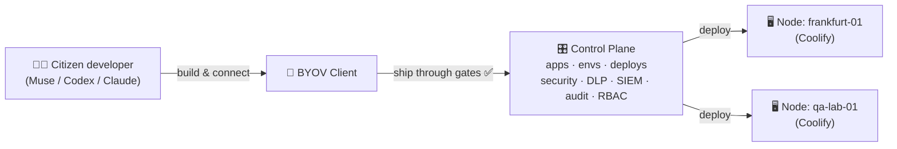

<div align="center">


# BYOV — Bring Your Own Vibe

**The secure framework for vibe-coded apps at work.**
Let employees build the tools they actually need — governed, deployed, and watched from one place.

[](https://nextjs.org/)
[](https://react.dev/)
[](https://www.typescriptlang.org/)
[](https://tailwindcss.com/)
[](https://vitest.dev/)
[](https://github.com/michalmie/byov/pulls)

[✨ Features](#-features) · [🚀 Quickstart](#-quickstart) · [🏗️ Architecture](#️-architecture) · [🗺️ Roadmap](#️-roadmap) · [🤝 Contributing](#-contributing)

</div>

---

## 😩 The problem

Your employees already vibe-code. With Muse, Codex, Claude — they spin up little apps that fix real daily pain: the maintenance queue, the leave spreadsheet, the invoice inbox.

But IT sees only risk:

- 🔓 Shadow apps with no security review, no DLP, no audit trail
- 🚫 Corporate blockers that ban vibe-coded tools outright — killing the productivity gain
- 🕳️ Deploys nobody owns, running who-knows-where, breaking silently

**Blocking doesn't work. Governing does.**

## 💡 The idea

**BYOV (Bring Your Own Vibe)** gives citizen developers a paved road:

> 🧑‍💻 **Build** whatever helps your daily job, in the coding tool you love →
> 🛡️ **Pass** automatic gates (tests, DLP, audits) →
> 🚀 **Ship** to company-approved infrastructure →
> 👀 **Watch** everything from one control plane.

Employees keep their flow. Admins keep control. Everybody wins.

---

## ✨ Features

| | What | Why it matters |
|---|---|---|
| 🎛️ | **Control Plane** — one UI for apps, environments, deployments | Every vibe-coded app, visible and manageable |
| 🖥️ | **Nodes** — admin-approved deployment targets (self-hosted Coolify first) | Apps land only where they're allowed to |
| 🔌 | **Client** — connect straight from Muse, Codex, Claude & co. | Zero-friction path from prompt to production |
| 🧩 | **Tech stacks** — paved-road starters with gates built in | Start compliant on the BYOV stack; more stacks later |
| ✅ | **Required checks** — unit tests, lint, builds, DLP scan, dependency audit | Nothing ships without passing the gates |
| 🏥 | **Fleet health** — app health rolled up from envs + checks | Spot trouble before users do |
| 📜 | **Audit trail & RBAC** — who shipped what, when, where | Compliance without spreadsheets |
| 📡 | **SIEM-ready events** — security signals flow to your SOC | Shadow IT becomes observed IT |

> 🧪 **Status: early build.** The Control Plane UI first slice (dashboard, apps, nodes) is live on sample data. API, real nodes, and the client are on the [roadmap](#️-roadmap).

---

## 👀 Tour

Run it once and click through:

| Route | What you'll see |
|---|---|
| `/` | 📊 **Dashboard** — fleet figures, app health table, nodes, activity feed |
| `/apps` | 📦 **Apps** — every app with health, home node, and last deploy |
| `/apps/new` | ➕ **New app** — register an app; it starts with a Sandbox and an owner guide |
| `/apps/[slug]` | 🔍 **App detail** — environments, deployment history, required checks |
| `/stacks` | 🧩 **Tech stacks** — starter stacks with gates and scaffold steps |
| `/stacks/[slug]` | 🔍 **Stack detail** — tech stack, checks, scaffold, ship targets |
| `/nodes` | 🖥️ **Nodes** — deployment targets and the apps pinned to each |
| `/activity` | ⚡ **Activity** — every control plane event, newest first |
| `/settings` | ⚙️ **Settings** — workspace preferences, tech stacks and nodes |

Sample fleet included: `shopfloor-tickets`, `leave-balancer` (watch the failed DLP gate ⛔), `invoice-triage`, and `lab-inventory` (mid-deploy 🛫).

---

## 🏗️ Architecture

Three parts, one flow:



- **Control Plane** — the central UI: create apps, manage environments, deploy, enforce security, DLP, SIEM, audit trails, and RBAC.
- **Nodes** — deployment targets. Admins decide where apps go and in which environments. First supported type: **self-hosted Coolify**.
- **Client** — how an employee connects an app directly from their coding tool.

Health rolls up honestly: an env that's `down` sinks the app; a failed check or `degraded` env flags attention; `deploying` shows motion. See [`appHealth()`](lib/control-plane.ts) — pinned by unit tests.

---

## 🚀 Quickstart

**Prerequisites:** Node.js 20+ and npm.

```bash
# 1. Clone
git clone https://github.com/michalmie/byov.git
cd byov

# 2. Install
npm ci

# 3. Configure (a Postgres database is required)
cp .env.example .env.local
# then set DATABASE_URL in .env.local — see docs/database.md

# 4. Run 🎉
npm run dev
```

Open the local address printed by the dev server (default port `3014`) and explore the dashboard. All figures are sample data for now — the UI says so.

### 🧪 Checks

```bash
npm run test:unit   # unit tests (Vitest)
npm run lint        # ESLint
npm run typecheck   # TypeScript
npm run build       # production build
```

---

## 🛠️ Tech stack

| Layer | Choice |
|---|---|
| Framework | [Next.js 16](https://nextjs.org/) (App Router) |
| UI | [React 19](https://react.dev/), [Tailwind CSS 4](https://tailwindcss.com/) |
| Language | [TypeScript 5](https://www.typescriptlang.org/) (strict) |
| Database | [Postgres](https://www.postgresql.org/) (required, via `DATABASE_URL`) |
| Tests | [Vitest 4](https://vitest.dev/) + Testing Library |
| First node type | [Coolify](https://coolify.io/) (self-hosted) |

Project layout:

```
app/            # routes: dashboard (/), /apps, /apps/[slug], /stacks, /stacks/[slug], /nodes, /activity, /settings
components/     # shell, sidebar, subnav, data UI
lib/            # control-plane dataset + roll-up logic, site helpers, stack registry
stacks/         # tech stacks: manifest + setup guide + blueprint per stack
tests/unit/     # Vitest suites
deploy/         # deployment & preview adapters
```

---

## 🗺️ Roadmap

- [x] Control Plane UI first slice (dashboard, apps, nodes) on sample data
- [x] Tech stacks catalog (BYOV stack first)
- [x] Postgres-backed API behind the Control Plane (machine `/api/v1` + workspace `/api/workspace`)
- [ ] Coolify node adapter — deploy for real
- [ ] Client for Muse / Codex / Claude
- [x] More tech stacks beyond the BYOV stack (AI chatbot, React SPA, Python API as drafts + workspace-defined customs)
- [ ] Preview URLs per branch with SSO protection
- [ ] Auth, RBAC, and audit trails
- [ ] DLP + SIEM integrations
- [ ] More node types (Kubernetes, …?)

Have an opinion on what lands next? [Open an issue](https://github.com/michalmie/byov/issues) — we'd love to hear it.

---

## 🤝 Contributing

Contributions are welcome! The workflow is simple:

1. Fork & branch from `main`
2. Keep `npm run test:unit`, `npm run lint`, `npm run typecheck`, and `npm run build` green
3. Add or update unit tests for behavior changes
4. Open a PR with a clear description

Please follow the working rules in [`REQUIREMENTS.md`](REQUIREMENTS.md) (commit meaningfully, keep tests current) and keep this repo public-safe: no secrets, env values, logs, or real data.

---

## 📄 License

License to be announced.

---

<div align="center">

**If BYOV resonates, ⭐ star the repo — it helps more teams find the paved road for vibe coding.**

Built with 💜 for everyone who ever fixed work with a side project.

</div>
